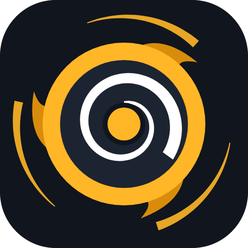

<div align="center">



<h1>Lobo</h1>

<p><b>Spin. Clash. Ring them out.</b><br>
A 3D spinning-top battle game you play in the browser, steering by tilting your phone.</p>

<p><a href="https://atymia.github.io/Lobo/"></a></p>

<p>

</p>

<p><a href="#how-a-battle-works">How it works</a> ·
<a href="#the-beys">The beys</a> ·
<a href="#modes">Modes</a> ·
<a href="#controls">Controls</a> ·
<a href="#on-your-phone">On your phone</a></p>


</div>

---

Lobo is a hobby project of mine. I grew up with the first Beyblade series, so I wanted to make a little battle game about spinning tops (and I added Zeus from G-Revolution, because I couldn't leave him out). You pick a bey, launch it into the stadium and try to knock the other one out of the ring, or just outlast it.

There's a joystick on screen, but on a phone you steer by tilting it, and honestly that's the fun part.

Nothing to download and no account. You open the link and play.

## How a battle works

Both beys start at full spin, and spin is basically your health. It goes down slowly on its own and a lot faster when you take hits. A round ends when a bey stops spinning, gets knocked into one of the KO pockets in the wall, or when time runs out (then whoever has more spin left wins). First to 2 rounds wins the match.

What I cared about most is that you win because of how you play, not because of your bey's stats:

- The faster you're going when you crash into the other bey, the more spin it loses. Whoever charges in does most of the damage, so sitting back doesn't really work.
- Stats are there, but they only change damage by a few percent. A defense type is harder to push and an attack type is quicker, that's about it.
- Two beys grinding against each other won't keep draining spin. Only real hits count.
- Every special can be dodged. There's always a warning first (a target on the ground, lightning markers, a ring closing in), and if you move in time it misses.

To check that no bey is simply better than the others, I let the CPU play thousands of battles against itself on the real game code. At the same skill level every bey wins somewhere between 40 and 60% of its games.

## The beys

Each bey has a base move, which recharges quickly, goes where you're aiming and can miss (landing it fills your special faster), and a special move, the big one, which charges up during the fight.

| Bey | Base move | Special move |
|---|---|---|
| **Dragoon** | **Gale Trail**: a dash that leaves a gust behind. If the opponent crosses it, it gets blown sideways | **Sky Tornado**: a big tornado follows Dragoon, picks the opponent up and throws it wherever you steer |
| **Dranzer** | **Flame Arc**: a dash with a trail of fire that curves towards the opponent | **Phoenix Dive**: Dranzer takes off as a bird of fire, the target on the ground follows the opponent (you can tilt to adjust it) and then it dives. If it misses, Dranzer is stunned for a moment |
| **Black Dranzer** | **Dark Claw**: the strongest dash, in black flames, but missing costs some of its own spin | **Eclipse Drain**: a black sun rises and Black Dranzer drains spin from the opponent |
| **Driger** | **Twin Pounce**: two electric dashes in a row, and you can re-aim the second one | **Thunder Claw**: three claw slashes. Tap in time with the closing ring, and a perfect one brings down lightning |
| **Draciel** | **Iron Shell**: blocks most of the damage. Raise it right before a hit and it parries, sending the damage back | **Maelstrom**: Draciel anchors itself in a whirlpool that pulls the opponent in and slows it down |
| **Wolborg** | **Frost Howl**: a blast of freezing mist that slows down whatever it touches | **White Blizzard**: ice spikes come out of the floor and the whole stadium freezes. The opponent slides around, and one touch locks it in ice |
| **Zeus** | **Mirror Guard**: takes a hit, then fires it back with a dash | **Dark Dimension**: half of every hit on Zeus bounces back, and lightning strikes where the opponent is standing |

The effects (fire, wind, water, ice, darkness, lightning) are all drawn live with shaders and particles, and every move has its own sound, made in the browser instead of loaded from audio files.

## Modes

- **Tournament**: beat everyone in the bracket and take the title.
- **Quick Battle**: you against the CPU, best of 3.
- **Versus**: you against a friend, each on your own phone. One of you creates a room, the other types in the 4-letter code and you're in. Versus is still new and I'm testing it on different networks, so if it doesn't connect for you, [tell me](#feedback).

## Screenshots

<table>
  <tr>
    <th width="33%">Main menu</th>
    <th width="33%">Picking a bey</th>
    <th width="33%">In the arena</th>
  </tr>
  <tr>
    <td align="center"></td>
    <td align="center"></td>
    <td align="center"></td>
  </tr>
</table>

## Controls

| | Phone / tablet | Computer |
|---|---|---|
| **Steer** | Tilt the phone (or use the joystick) | Drag the on-screen joystick |
| **Base move** | Base button | Base button |
| **Special move** | Special button, once it's charged | Special button, once it's charged |
| **Recalibrate tilt** | *Recalibrate* on the result screen | – |

A few things I learned playing it:
- Go after your opponent. Whoever charges in does the damage.
- The base move goes where you were aiming when you pressed it, so line it up first.
- Landing base moves is the fastest way to get your special back.
- If you see a warning on the ground, get out of there.
- Stay away from the wall, that's where the KO pockets are.
- If the screen flips upright in the middle of a battle (it happens if you tilt too much), the game pauses until you turn the phone back.

## On your phone

Open **[atymia.github.io/Lobo](https://atymia.github.io/Lobo/)** and turn the phone sideways. It's even better if you add it to your home screen, because then it opens fullscreen like a normal app.

| iPhone (Safari) | Android (Chrome) |
|---|---|
| 1. Tap **Share** (the square with the arrow) | 1. Tap **⋮** in the top right |
| 2. Scroll down and tap **Add to Home Screen** | 2. Tap **Add to Home screen** (or **Install app**) |
| 3. Tap **Add** | 3. Confirm |

Good to know:
- You need an internet connection, because the 3D engine loads online.
- On iPhone the game asks to use the motion sensors the first time. Tap **Allow** or tilting won't work.
- On iPhone there's no sound while the silent switch is on.
- If you still see an old version after an update, close the app completely and open it again. The version number is on the start screen.

## Feedback

If you find a bug or have an idea, open an [issue](https://github.com/Atymia/Lobo/issues). It really helps if you tell me:
- the version on the start screen,
- your phone or computer and browser (for example *iPhone 15, Safari*),
- what happened, and which beys were fighting.

## What's next

- [x] Damage based on skill, not stats
- [x] New base and special moves with proper effects
- [x] A sound for every move
- [x] Versus mode (phone vs phone)
- [ ] Original names and artwork
- [ ] Real 3D models for each bey
- [ ] More beys
- [ ] Offline play
- [ ] Music

<details>
<summary><b>How it's built</b></summary>

<br>

There's no build step and nothing to install. It's plain HTML and JavaScript, with Three.js loaded from a CDN, and GitHub Pages hosts it straight from this repository.

To try changes locally any static server works:

```bash
python3 -m http.server 8000
# then open http://localhost:8000
```

Opening `index.html` straight from disk mostly works, but the motion sensors and the home-screen install need a server (and HTTPS on a phone). After pushing an update, hit Ctrl+F5, because browsers love keeping old files around.

```
├── index.html      screens and buttons
├── style.css       look and layout, phone/landscape rules included
├── game.js         the game: physics, combat, moves, CPU, controls, 3D scene
├── fx.js           what the moves look like: shaders, particles, glow
├── sfx.js          what the moves sound like, made with the Web Audio API
├── net.js          Versus mode: rooms and keeping the two phones in sync
├── beys.js         the beys: stats, colors, move names and timings
├── hit.mp3         the clash sound
├── manifest.json   name, icon and orientation for the home-screen app
├── LICENSE         terms of use
└── images/         banner, screenshots and icons
```

If you're curious where things are:
- stats, colors and moves of each bey → `beys.js`
- combat numbers (damage, knockback, parry window…) → top of `game.js`
- what each move does → `triggerBaseMove` and `stepSpecial` in `game.js`
- how each move looks → the `kit…` functions in `fx.js`
- how each move sounds → the `BASE`, `SPECIAL` and `EVENTS` tables in `sfx.js`
- stadium size, walls and KO pockets → `ARENA` and `buildStadium` in `game.js`

</details>

## Credits

Made with [Three.js](https://threejs.org/) (r128). Versus mode uses [PeerJS](https://peerjs.com/) (MIT License). Fonts: [Inter](https://rsms.me/inter/), Bebas Neue and Roboto Mono from Google Fonts.

Lobo is an independent, non-commercial fan project. It isn't affiliated with or endorsed by the owners of Beyblade or any related toy or series, and all trademarks belong to their respective owners.

## License

© 2026 MrHide (Atymia). **All rights reserved.**

This isn't an open source project. You're welcome to play the game and read the code, but please don't copy, reuse, republish or sell the code, graphics or sounds without asking me first. The full terms are in [LICENSE](LICENSE). If you'd like to use something from the project, just [open an issue](https://github.com/Atymia/Lobo/issues) and ask.
